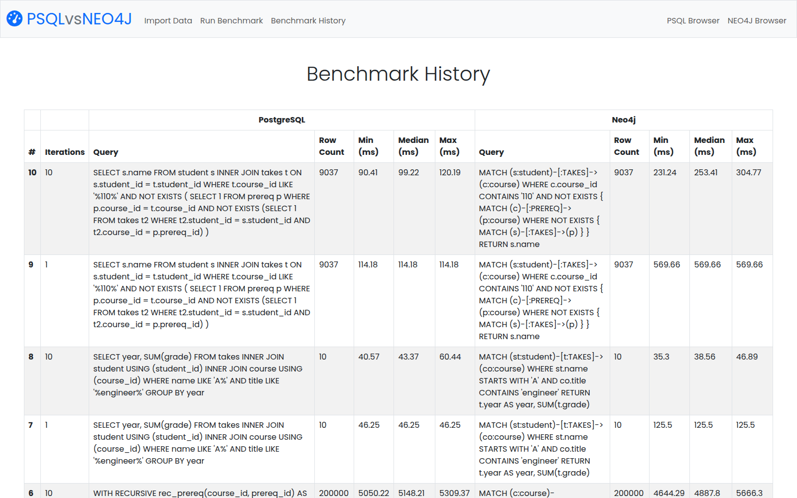
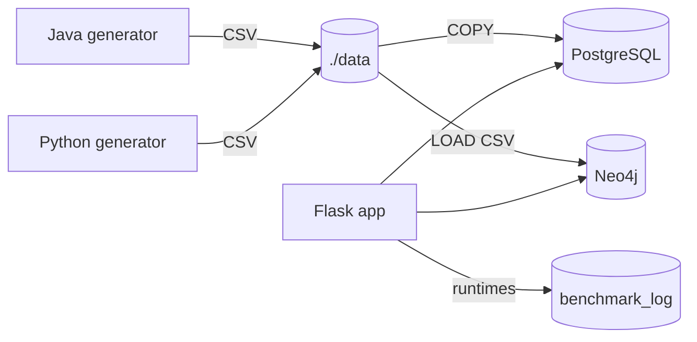

<div align="center">

# PostgreSQL vs Neo4j Web Benchmark

[](requirements.txt)
[](requirements.txt)
[](docker-compose.yaml)
[](docker-compose.yaml)
[](LICENSE)

Run the same question as SQL and as Cypher, side by side, and compare how fast PostgreSQL and Neo4j answer it.

[Overview](#overview) • [Getting started](#getting-started) • [Sample benchmarks](#sample-benchmarks) • [How it works](#how-it-works)



</div>

## Overview

This is a web app for comparing a relational database with a graph database on the same data. It loads two generated datasets into both PostgreSQL and Neo4j. Then you can write a query pair (one SQL, one Cypher), run each one N times, and look at the timings on a history page.

- **Two datasets.** `warehouse` is a join-heavy business schema with 2.6M rows. `university` holds 200K course prerequisites linked in chains 100 levels deep, which suits recursive queries.
- **Same data in both databases.** The generators write CSV files once. PostgreSQL loads them with `COPY`, and Neo4j loads them with `LOAD CSV`.
- **Fair timing.** Both databases are timed the same way, on the client, from sending the query until every row is fetched and the transaction is committed.
- **Saved queries.** Five sample query pairs come preloaded, and you can save your own from the UI.
- **Benchmark history.** Every run is stored with its per-run times, row counts, and min, median and max.

## Getting started

### Prerequisites

- [Docker](https://docs.docker.com/get-docker/) with Docker Compose v2
- [Task](https://taskfile.dev/installation/)
- About 8 GB of free RAM. Neo4j is set to a 4–6 GB heap.

### Run it

```bash
task up         # build the app image and start the app, PostgreSQL, Neo4j and pgAdmin
task generate   # generate both datasets into ./data and reset the databases (about 2 minutes)
```

Then open http://localhost:5000:

1. **Import Data**: choose a dataset, tick both databases, and click **Import**. Do this once for `warehouse` and once for `university`.
2. **Run Benchmark**: pick a sample from **Select Query**, or write your own pair, then click **Run**.
3. **Benchmark History**: compare the results.

> [!WARNING]
> The app runs any SQL or Cypher you type, with full database rights. Keep it on `localhost`.

### Tasks

| Task | What it does |
| --- | --- |
| `task up` | Build and start all services, and wait until they are healthy |
| `task down` | Stop all services and keep their data |
| `task clean` | Stop all services and delete database volumes and build output |
| `task generate` | Run both data generators, then `db:init` |
| `task db:init` | Drop and recreate the PostgreSQL databases and empty Neo4j |
| `task logs` | Follow the app logs |
| `task sass` | Watch the SASS files and rebuild the CSS |

| Service | URL | Login |
| --- | --- | --- |
| Web app | http://localhost:5000 | none |
| pgAdmin | http://localhost:5050 | `admin@admin.com` / `admin` |
| Neo4j Browser | http://localhost:7474 | `neo4j` / `12345678` |

Credentials live in `.env`. `task up` creates it from [`.env.example`](.env.example).

## Sample benchmarks

These are the five preloaded query pairs. Each one ran once as a warm-up, then 10 more times. Times are in milliseconds. In every pair, both databases return the same rows.

| Query | Dataset | Rows | PostgreSQL min / median / max | Neo4j min / median / max | Faster |
| --- | --- | ---: | --- | --- | --- |
| Work price from work hours (2 joins) | warehouse | 10,000 | 92 / **113** / 140 | 374 / **399** / 463 | PostgreSQL, 3.5× |
| Work price from hours and used items (4 joins) | warehouse | 10,000 | 523 / **543** / 703 | 787 / **814** / 885 | PostgreSQL, 1.5× |
| All prerequisites, recursive, 100 levels deep | university | 200,000 | 5,050 / **5,148** / 5,309 | 4,644 / **4,888** / 5,666 | Neo4j, 1.05× |
| Grade sums for filtered students and courses | university | 10 | 41 / **43** / 60 | 35 / **39** / 47 | Neo4j, 1.1× |
| Students who completed all prerequisites | university | 9,037 | 90 / **99** / 120 | 231 / **253** / 305 | PostgreSQL, 2.6× |

What the numbers show:

- **Joins and aggregates:** PostgreSQL wins clearly. Its hash joins and `GROUP BY` beat walking relationships one by one.
- **Deep recursive traversal:** the two are close, and Neo4j comes out a little ahead. Variable-length paths (`[:PREREQ*1..]`) are what a graph is built for, while `WITH RECURSIVE` has to rebuild its working table on every level.
- **Small, selective queries:** both finish in under 50 ms, and the gap is mostly noise.

<details>
<summary>Test setup</summary>

- Intel Core i7-10510U (4 cores, 8 threads), 16 GB RAM, Linux
- PostgreSQL 15.2 and Neo4j 5.6.0 Community, both in Docker with the settings in [`docker-compose.yaml`](docker-compose.yaml)
- Default generator sizes. Warehouse: 10K customers, 100K items, 100K invoices, 1M work–invoice links. University: 202K courses, 200K prerequisites, 10K students, 510K enrollments.
- The query text is in [`app/database/init_saved_queries.sql`](app/database/init_saved_queries.sql)

</details>

> [!NOTE]
> These numbers come from one laptop. They show a trend, not a ranking. Run `task generate` and the saved queries to get your own.

## How it works



- **Data generation:** the `warehouse` generator is a multi-threaded Java program. It builds rows in a PostgreSQL scratch database and exports them to CSV. The `university` generator is a Python script that uses Faker.
- **Graph model:** every table becomes a node label, and every foreign key or link table becomes one relationship, such as `(:work)-[:WORKHOURS {hours, discount}]->(:worktype)`. Each relationship is stored once, in one direction, the same way PostgreSQL stores one row.
- **Timing:** each run uses `time.perf_counter()` around execute, fetch all and commit. That's `psycopg` for PostgreSQL and the Neo4j driver's `execute_query` for Neo4j. Both include the network round trip and moving the results, so the comparison stays fair.

### Project layout

```text
app/
├── database/              # PostgreSQL schemas and the sample saved queries
├── templates/             # Jinja pages: import, run, history
├── import_data.py         # CSV → PostgreSQL (COPY) and Neo4j (LOAD CSV)
├── run_benchmark.py       # runs and times query pairs
└── benchmark_history.py   # min / median / max per run
data_generators/
├── warehouse/             # Java + Maven generator
└── university.py          # Python + Faker generator
Taskfile.yml               # all project commands
docker-compose.yaml        # app, PostgreSQL, Neo4j, pgAdmin
```
