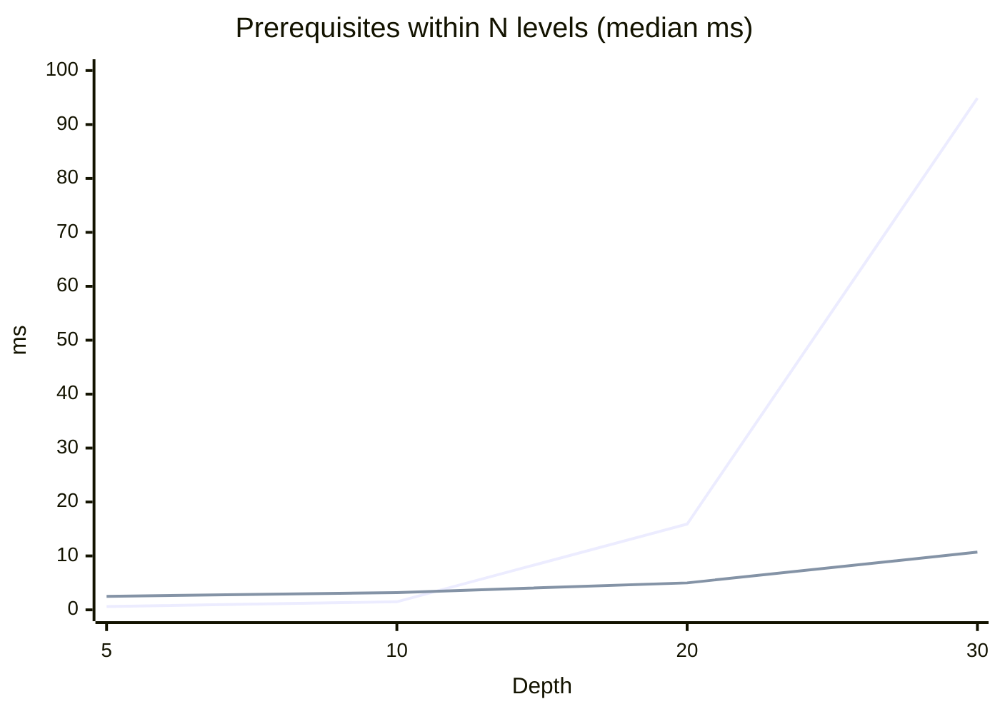
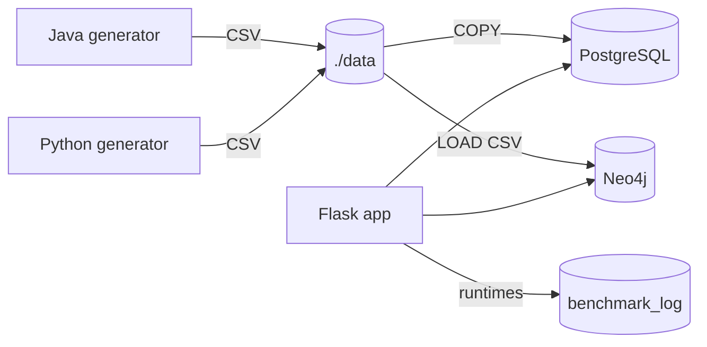

<div align="center">

# PostgreSQL vs Neo4j Web Benchmark

[](requirements.txt)
[](requirements.txt)
[](docker-compose.yaml)
[](docker-compose.yaml)
[](LICENSE)

Run the same question as SQL and as Cypher, side by side, and compare how fast PostgreSQL and Neo4j answer it.

[Overview](#overview) • [Getting started](#getting-started) • [PostgreSQL vs Neo4j](#postgresql-vs-neo4j) • [Sample benchmarks](#sample-benchmarks) • [How it works](#how-it-works)


</div>

## Overview

This is a web app for comparing a relational database with a graph database on the same data. It loads two generated datasets into both PostgreSQL and Neo4j. Then you can write a query pair (one SQL, one Cypher), run each one N times, and look at the timings on a history page.

- **Two datasets.** `warehouse` is a join-heavy business schema with 2.6M rows. `university` is a branching prerequisite graph (202K courses, 390K prerequisite links, up to 100 levels deep) with 10K students.
- **Same data in both databases.** The generators write CSV files once. PostgreSQL loads them with `COPY`, and Neo4j loads them with `LOAD CSV`.
- **Fair timing.** Both databases are timed the same way, on the client, from sending the query until every row is fetched and the transaction is committed.
- **Saved queries.** Eleven sample query pairs come preloaded, and you can save your own from the UI.
- **Benchmark history.** Every run is stored with its per-run times, row counts, and min, median and max.

## Getting started

### Prerequisites

- [Docker](https://docs.docker.com/get-docker/) with Docker Compose v2
- [Task](https://taskfile.dev/installation/)
- About 8 GB of free RAM. Neo4j is set to a 4–6 GB heap.

### Run it

```bash
task up         # build the app image and start the app, PostgreSQL, Neo4j and pgAdmin
task generate   # generate both datasets into ./data and reset the databases (about 2 minutes)
```

Then open http://localhost:5000:

1. **Import Data**: choose a dataset, tick both databases, and click **Import**. Do this once for `warehouse` and once for `university`.
2. **Run Benchmark**: pick a sample from **Select Query**, or write your own pair, then click **Run**.
3. **Benchmark History**: compare the results.

> [!WARNING]
> The app runs any SQL or Cypher you type, with full database rights. Keep it on `localhost`.

### Tasks

| Task | What it does |
| --- | --- |
| `task up` | Build and start all services, and wait until they are healthy |
| `task down` | Stop all services and keep their data |
| `task clean` | Stop all services and delete database volumes and build output |
| `task generate` | Run both data generators, then `db:init` |
| `task db:init` | Drop and recreate the PostgreSQL databases and empty Neo4j |
| `task logs` | Follow the app logs |
| `task sass` | Watch the SASS files and rebuild the CSS |

| Service | URL | Login |
| --- | --- | --- |
| Web app | http://localhost:5000 | none |
| pgAdmin | http://localhost:5050 | `admin@admin.com` / `admin` |
| Neo4j Browser | http://localhost:7474 | `neo4j` / `12345678` |

Credentials live in `.env`. `task up` creates it from [`.env.example`](.env.example).

## PostgreSQL vs Neo4j

Both databases can answer the same questions. They store the data differently, and that decides which questions are cheap.

| | PostgreSQL | Neo4j |
| --- | --- | --- |
| Data model | Tables of rows. A relationship is a foreign-key value. | Nodes and relationships, both stored as records. |
| Following a relationship | Matched at query time, with an index lookup or a hash join. | Each node record points to its relationships, so a hop is a pointer lookup ("index-free adjacency"). |
| How a query runs | Set-based: the planner joins whole tables and picks the strategy. | Pattern-based: start at some nodes, then walk outward. |
| Cost grows with | The size of the tables involved. | The part of the graph the query touches. |
| Strong at | Scans, filters, joins and aggregates over many rows. | Multi-hop and variable-depth traversals, paths, neighbourhoods. |
| Weak at | Recursive queries. Each level is another self-join, and the work piles up with depth. | Whole-dataset aggregates, plus a fixed cost of about 1.5 ms per query. |

### Why benchmark different use cases

- **There is no overall winner.** Run only the aggregate queries and PostgreSQL looks 2–4× faster. Run only shortest path and Neo4j looks 17× faster. Both are true, and each on its own is misleading.
- **The crossover point is what matters.** On this data, Neo4j only starts winning past about 10 levels of traversal. Knowing which side of that line your real queries fall on is more useful than any single score.
- **Fixed costs and growth rates are different things.** Neo4j pays more to start each query but less per hop. That matters for an API that makes hundreds of tiny lookups per request, and it doesn't matter for one deep traversal.
- **How you write the query matters.** The first, natural Cypher for recommendations was 5× slower than an equivalent rewrite. PostgreSQL's planner fixed the same pattern on its own. A benchmark of only one shape would never show this.

Rule of thumb from these results: if most of your queries are reports, filters and aggregates, use PostgreSQL. If they follow relationships to an unknown or large depth (dependency graphs, routes, fraud rings, recommendations at scale), Neo4j earns its keep. Many systems run both.

## Sample benchmarks

The eleven preloaded query pairs are picked so each database gets cases it should win. Each pair ran once as a warm-up, then 10 more times. Times are medians in milliseconds (min / max are in the history page). Every pair returns exactly the same values on both databases.

| # | Query | Expected | PostgreSQL | Neo4j | Faster |
| ---: | --- | --- | ---: | ---: | --- |
| 1 | Work price for every work (2 joins, 10K rows) | PostgreSQL | **103** | 368 | PostgreSQL, 3.6× |
| 2 | Top 10 customers by revenue (4 joins over 1M links) | PostgreSQL | **1,510** | 3,259 | PostgreSQL, 2.2× |
| 3 | One customer by id | Neutral | **0.2** | 2.3 | PostgreSQL, 12× |
| 4 | Distinct items used by one customer (3 hops) | Neo4j | **0.8** | 3.9 | PostgreSQL, 4.7× |
| 5 | Prerequisites of one course, depth ≤ 5 (39 courses) | Neo4j | **0.6** | 2.5 | PostgreSQL, 4.3× |
| 6 | Same, depth ≤ 10 (175 courses) | Neo4j | **1.5** | 3.2 | PostgreSQL, 2.1× |
| 7 | Same, depth ≤ 20 (1,177 courses) | Neo4j | 15.9 | **5.0** | Neo4j, 3.2× |
| 8 | Same, depth ≤ 30 (3,557 courses) | Neo4j | 94.9 | **10.7** | Neo4j, 8.8× |
| 9 | Shortest prerequisite path between two courses (28 hops) | Neo4j | 76.5 | **4.5** | Neo4j, 17× |
| 10 | Top 10 course recommendations from classmates | Neo4j | **6.8** | 12.6 | PostgreSQL, 1.9× |
| 11 | Level-110 enrollments with all prerequisites completed | Open | 202 | **143** | Neo4j, 1.4× |

The depth sweep (queries 5–8) shows where the lines cross:



<sup>Steep line: PostgreSQL. Flat line: Neo4j.</sup>

What the numbers show:

- **Scans, joins and aggregates belong to PostgreSQL.** Queries 1 and 2 touch most of the data, and set-based hash joins beat following relationships one at a time.
- **Small lookups are a tie between the engines.** The fixed cost per query decides them. Neo4j pays about 1.5 ms per call before doing any work: about 0.5 ms in the Python driver, and about 1 ms on the server to open and close the transaction. PostgreSQL pays about 0.16 ms. Without that cost, the engines are even (see the table below).
- **Deep traversals belong to Neo4j.** A recursive CTE keeps every *(course, depth)* pair it reaches, so its work grows with depth. Neo4j walks the graph breadth-first and visits each course once. Past depth 10 the gap widens fast: 3× at depth 20, 9× at depth 30, and 17× for shortest path, where Neo4j searches from both ends.
- **Recommendations (query 10) went against expectations.** The first Cypher version checked "did I already take this course?" once per candidate row, about 250K storage reads, and took 57 ms. Collecting my courses once and filtering against that list gives the same result in 12.6 ms. PostgreSQL still wins: its planner turns `NOT EXISTS` into one hash anti-join by itself. And with about 5 students per course, the neighbourhood is small (about 16K rows), so there's little graph to walk. Neo4j Community also lacks the faster query runtime, which is Enterprise-only.

Engine time only, without the fixed cost per query. PostgreSQL time comes from `EXPLAIN (ANALYZE, TIMING OFF)`. Neo4j time is the server time from the driver's result summary, which only reports whole milliseconds.

| # | Query | PostgreSQL engine | Neo4j engine |
| ---: | --- | ---: | ---: |
| 4 | Items used by one customer (3 hops) | 0.84 | ~1 |
| 5 | Depth ≤ 5 | 0.40 | ~1 |
| 6 | Depth ≤ 10 | 1.30 | ~1 |
| 7 | Depth ≤ 20 | 18.2 | ~3 |
| 8 | Depth ≤ 30 | 99.3 | ~7 |
| 9 | Shortest path | 76.4 | ~2 |

<details>
<summary>Test setup</summary>

- Intel Core i7-10510U (4 cores, 8 threads), 16 GB RAM, Linux
- PostgreSQL 15.2 and Neo4j 5.6.0 Community, both in Docker with the settings in [`docker-compose.yaml`](docker-compose.yaml). PostgreSQL has foreign-key indexes and fresh `ANALYZE` statistics. Neo4j has uniqueness constraints on every id.
- Default generator sizes. Warehouse: 10K customers, 100K items, 100K invoices, 1M work–invoice links. University: 202K courses, 390K prerequisite links, 10K students, 544K enrollments.
- The university generator is seeded, so `task generate` rebuilds the same graph. The query text is in [`app/database/init_saved_queries.sql`](app/database/init_saved_queries.sql).

</details>

> [!NOTE]
> These numbers come from one laptop. They show a trend, not a ranking. Run `task generate` and the saved queries to get your own.

## How it works



- **Data generation:** the `warehouse` generator is a multi-threaded Java program. It builds rows in a PostgreSQL scratch database and exports them to CSV. The `university` generator is a Python script that uses Faker.
- **Graph model:** every table becomes a node label, and every foreign key or link table becomes one relationship, such as `(:work)-[:WORKHOURS {hours, discount}]->(:worktype)`. Each relationship is stored once, in one direction, the same way PostgreSQL stores one row.
- **Fair setup:** PostgreSQL gets an index on every foreign key and runs `ANALYZE` after each import, so joins can start from either side, the way Neo4j relationships can.
- **Timing:** each run uses `time.perf_counter()` around execute, fetch all and commit. That's `psycopg` for PostgreSQL and the Neo4j driver's `execute_query` for Neo4j. Both include the network round trip and moving the results, so the comparison stays fair.

### Project layout

```text
app/
├── database/              # PostgreSQL schemas and the sample saved queries
├── templates/             # Jinja pages: import, run, history
├── import_data.py         # CSV → PostgreSQL (COPY) and Neo4j (LOAD CSV)
├── run_benchmark.py       # runs and times query pairs
└── benchmark_history.py   # min / median / max per run
data_generators/
├── warehouse/             # Java + Maven generator
└── university.py          # Python + Faker generator
Taskfile.yml               # all project commands
docker-compose.yaml        # app, PostgreSQL, Neo4j, pgAdmin
```
